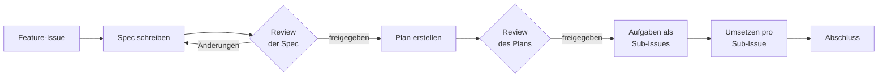

# Ablauf für Stufe 3: Spezifikation, Plan, Umsetzung

Für größere Änderungen (siehe [Leitfaden](when-to-use-what.md)). Grundidee: Menschen treffen die fachlichen Entscheidungen, bevor Code entsteht. Die Spezifikation liegt im Repo, wird reviewt und bleibt aktuell.

## Ablage im Projekt-Repo

Ein Ordner pro Feature, nummeriert. Vision, Rollen, Personas und Begriffe stehen in `docs/product/`.

```
docs/specs/
├── 001-<feature>/
│   ├── spec.md            Was und warum
│   └── plan.md            Wie
└── 002-<feature>/
    ├── spec.md
    └── plan.md
```

Die leeren Vorlagen liegen in `templates/spec.md` und `templates/plan.md`.

## Ablauf



1. **Feature-Issue anlegen** mit der Vorlage „Feature (Spezifikation)“.
2. **Spezifikation schreiben** auf einem eigenen Branch, z. B. `5-spec-wishes`. Vorlage nach `docs/specs/001-<feature>/spec.md` kopieren. Gern im Dialog mit der KI, die Fragen stellt – entscheiden tun Menschen.
3. **Pull Request nur mit der Spezifikation**, noch ohne Code. Das Team prüft die fachlichen Regeln und offenen Fragen. Erst wenn alles geklärt ist: Status „Freigegeben“, mergen.
4. **Plan erstellen** auf einem neuen Branch, gern vom Agenten vorgeschlagen. Prüfen und mergen.
5. **Aufgaben als Sub-Issues anlegen:** jede Zeile der Aufgabentabelle wird ein Issue nach der Vorlage „Kleine Änderung“ und wird im Feature-Issue unter „Sub-issues“ verknüpft.
6. **Umsetzen pro Sub-Issue:** Branch, Agent, selbst prüfen, Pull Request mit `Closes #<nr>`, Review gegen die Akzeptanzkriterien der Spec, Merge.
7. **Abschluss:** Alle Sub-Issues erledigt, Akzeptanzkriterien geprüft, Spec auf „Umgesetzt“, Feature-Issue schließen.

## Regel gegen Spec-Drift

Ändert sich später das Verhalten, wird **zuerst die Spezifikation** angepasst – im selben Pull Request wie der Code. Die Pull-Request-Vorlage fragt das ab.

## Prompts für den Agenten

Spezifikation im Dialog:
```
Wir schreiben gemeinsam die Spezifikation in docs/specs/001-<feature>/spec.md nach templates/spec.md.
Feature: <Kurzbeschreibung>
Stelle mir Fragen, immer nur eine auf einmal, bis alle fachlichen Regeln klar sind.
Schlage zu jeder Frage eine Antwort vor, aber ich entscheide.
Kein Code, nichts zur technischen Umsetzung. Trage meine Entscheidungen in die Tabelle „Entscheidungen“ ein.
```

Plan:
```
Lies docs/specs/001-<feature>/spec.md und erstelle docs/specs/001-<feature>/plan.md nach templates/plan.md.
Noch keinen Code schreiben.
```

Umsetzung einer Aufgabe:
```
Setze Aufgabe T1 aus docs/specs/001-<feature>/plan.md um.
Halte dich an die Regeln und Akzeptanzkriterien in docs/specs/001-<feature>/spec.md.
```
