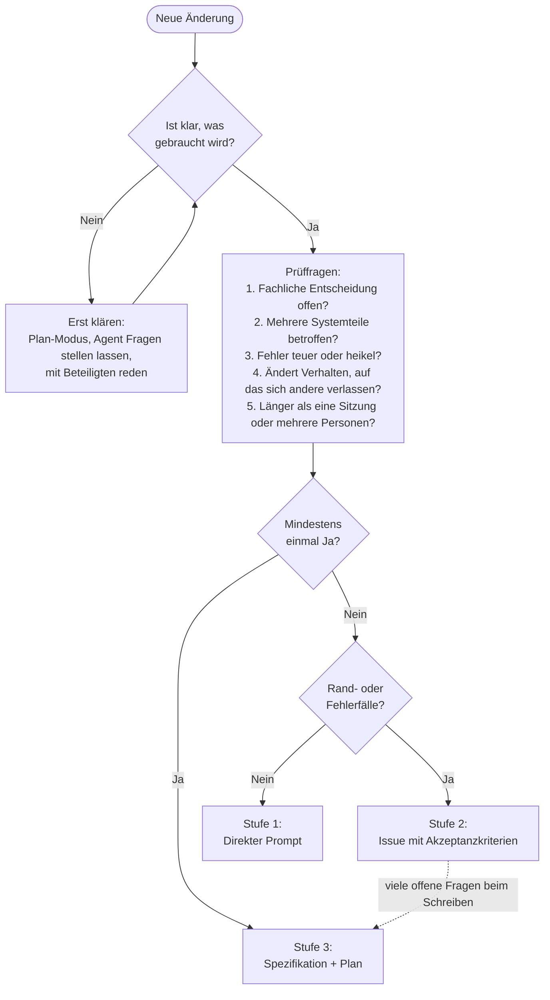

# Leitfaden: Wann reicht ein Issue, wann braucht es eine Spezifikation?

Der Aufwand richtet sich danach, wie viele Entscheidungen offen sind und wie teuer ein Fehler wäre.

## Die drei Stufen

| Stufe | Wann | Was |
| --- | --- | --- |
| 1. Direkter Prompt | Eindeutig, nur eine Stelle, nichts zu entscheiden | Ein Satz an den Agenten |
| 2. Issue | Klar umrissen, aber mit Rand- oder Fehlerfällen | Issue-Vorlage „Kleine Änderung“: Ziel, Akzeptanzkriterien, Prüfung |
| 3. Spezifikation + Plan | Fachliche Entscheidungen offen, mehrere Teile betroffen oder ein Fehler wäre teuer | `spec.md` mit Review, dann `plan.md`, dann Umsetzung in mehreren Issues |

## Die Prüffragen

Wird eine davon mit Ja beantwortet, ist es Stufe 3.

1. Muss etwas fachlich entschieden werden, das noch niemand festgelegt hat?
2. Sind mehrere Teile des Systems betroffen (z. B. Datenmodell, Oberfläche und Logik)?
3. Wäre ein Fehler teuer oder heikel (Sicherheit, Rechte, Datenschutz, Datenverlust, schwer rückgängig zu machen)?
4. Ändert sich Verhalten, auf das sich andere verlassen?
5. Dauert es länger als eine Sitzung, oder arbeiten mehrere Personen daran?

## Faustregeln

- **Erst klären, dann einstufen:** Ist unklar, was gebraucht wird, zuerst im Plan-Modus mit dem Agenten durchsprechen oder mit den Beteiligten reden.
- **Hochstufen, wenn es beim Schreiben hakt:** Werden die offenen Fragen im Issue länger als die Akzeptanzkriterien, ist es keine kleine Änderung.
- **Im Zweifel klein anfangen:** Eine Spezifikation für Kleinigkeiten ist Overhead. Lieber ein Issue schreiben und bei Bedarf hochstufen.

## Beispiele

| Änderung | Stufe | Warum |
| --- | --- | --- |
| Tippfehler auf einem Button korrigieren | 1 | Eindeutig, nur eine Stelle |
| Spalte „Kapazität“ in einer Übersicht anzeigen | 1 | Nur Anzeige, nichts zu entscheiden |
| Liste nach Auslastung sortieren | 2 | Klar, aber Randfall: Einträge ohne Daten |
| Export als CSV | 2 | Klar, aber Format und Inhalt als Akzeptanzkriterien |
| Erinnerungen an Nutzer verschicken | 3 | Fachliche Entscheidungen (wann, wie oft?), Datenschutz |
| Zuteilungsalgorithmus ändern | 3 | Fachliche Regeln, betrifft alle Nutzer |
